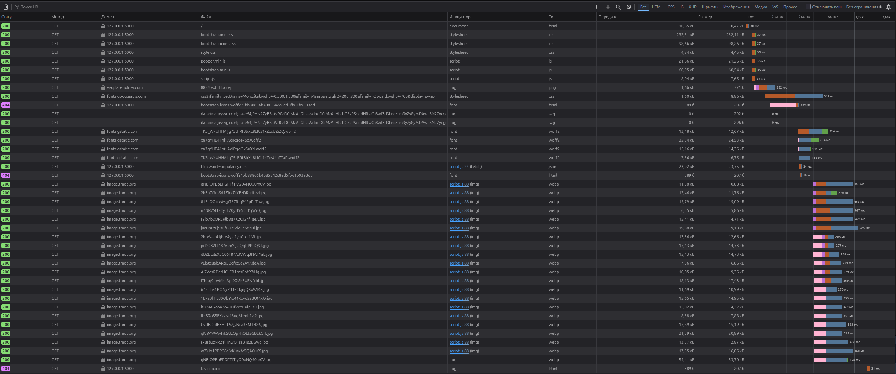

- сделать кэширование изображений на сервре, секунду грузиться страница из-за доступа к изображениям с апи

- переместить шрифты в static, убрать импорт с гугла
- сделать чтобы в постере кнопки прилипали снизу
- выровнять логотип и кнопки в header
- сделать чтобы текст в футере был ниже
- починить сортировку
- сделать функцию рандомного фильма
- сделать кэширование изображений на сервере
- перевести все иконки на сервер